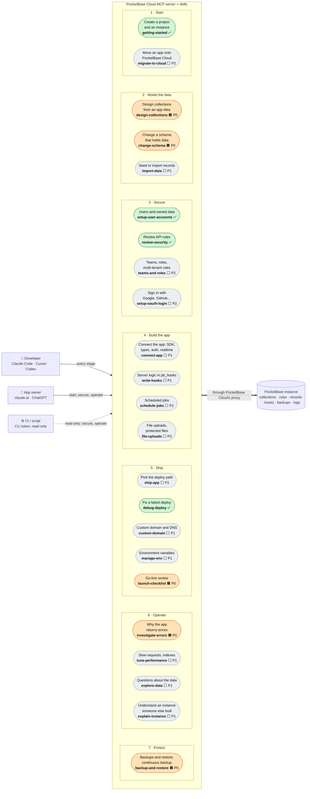
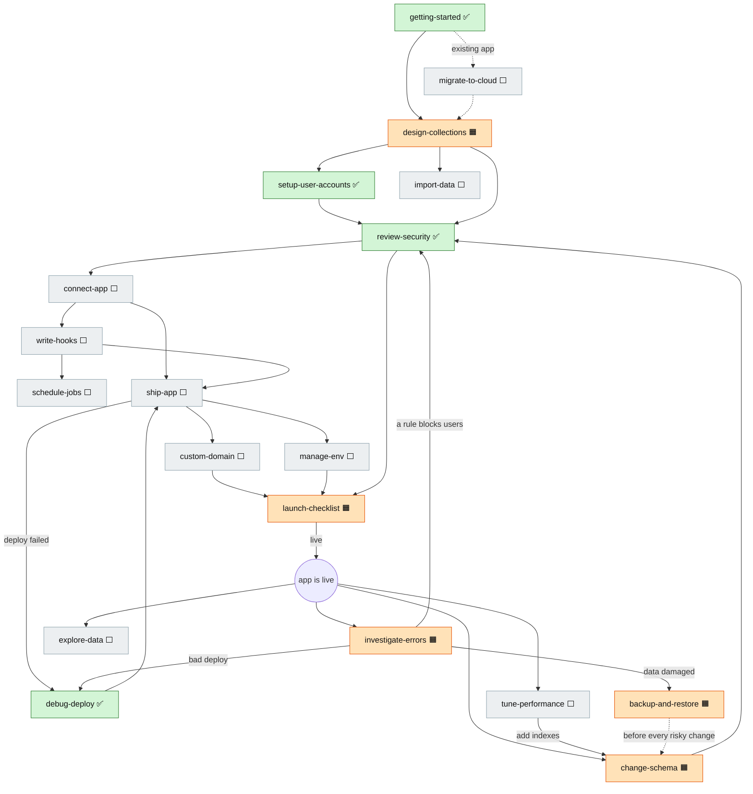
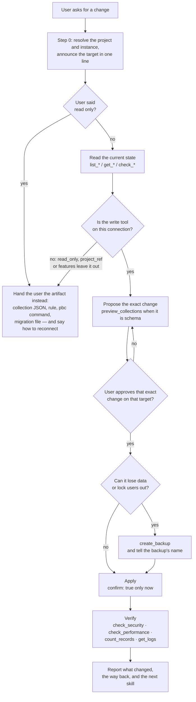
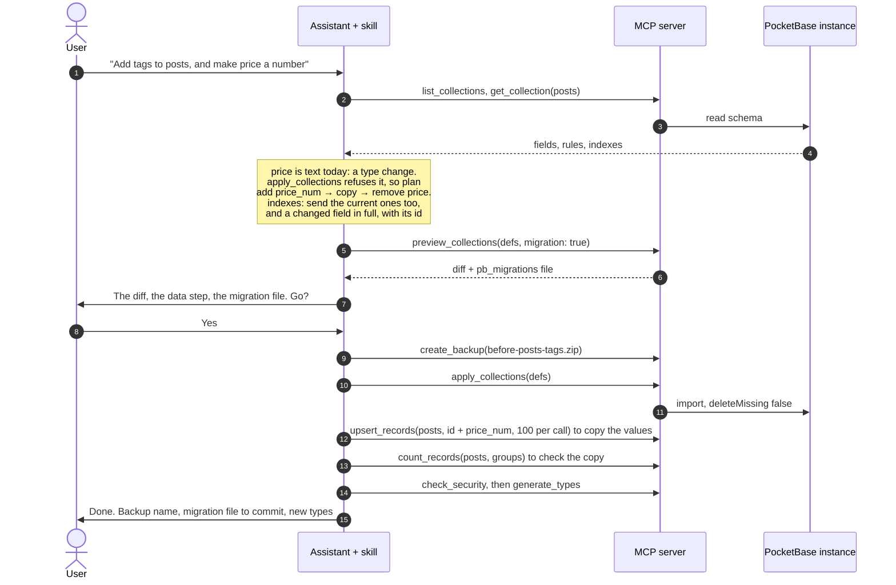
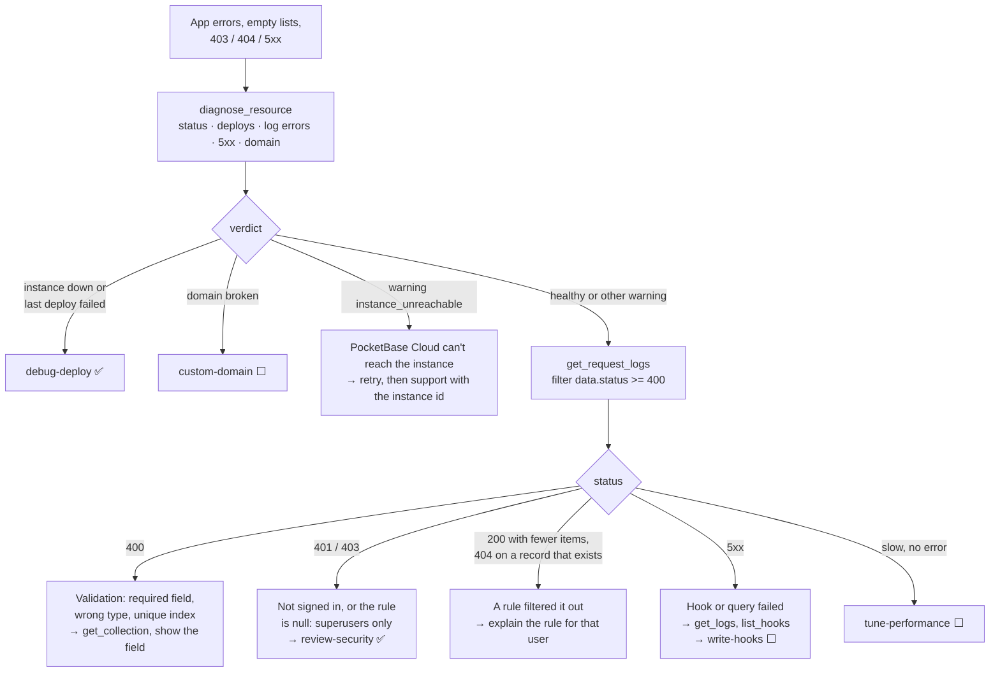
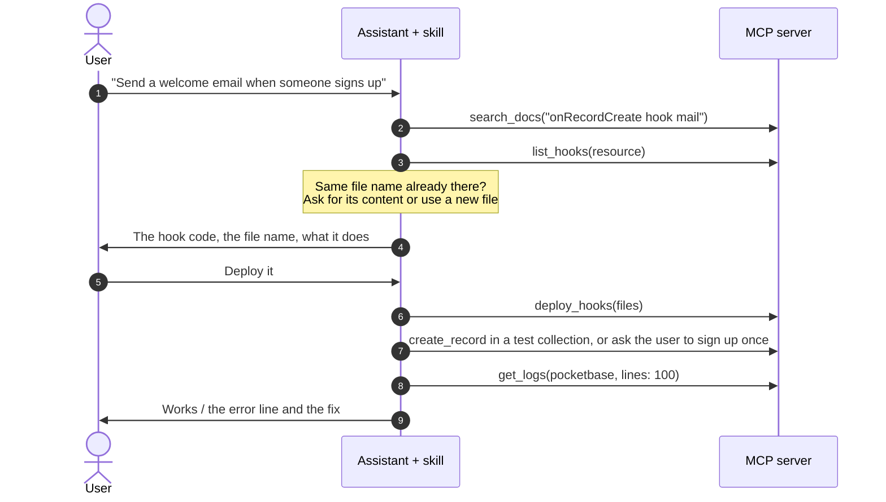
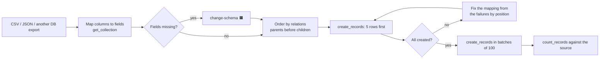
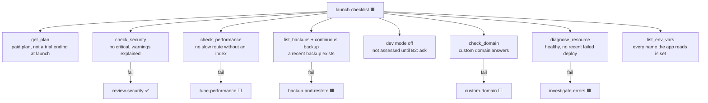

# Use cases

What people need to do with PocketBase on PocketBase Cloud, who does it, and which skill (shipped or proposed) carries
it. The diagrams are Mermaid, so GitHub renders them in place.

Legend used in every diagram:

| Mark | Meaning |
|---|---|
| ✅ | A skill that ships today in [`skills/`](../../skills/) |
| 🟧 **P0** | Proposed next: frequent, or risky without guidance, and every tool it needs exists (`backup-and-restore` is the exception: its way back for a deleted collection or field needs a server tool, so it ships last) |
| ⬜ P1 / P2 | Proposed later |

## Actors

| Actor | Works in | Typical asks |
|---|---|---|
| **Developer** | Claude Code, Cursor, Codex, VS Code, Gemini CLI: skills installed with the plugin | "Add a `comments` collection", "why is `/api/collections/posts/records` slow?", "write a hook that emails on sign-up" |
| **App owner** | claude.ai, ChatGPT: connector only, so the server's prompts, not the skills | "How many orders were paid this week?", "is my app up?", "is my data safe?" |
| **CI or script** | A CLI token, usually `read_only=true` and one `project_ref` | Health and security checks on a schedule |
| **PocketBase instance** | Reached only through PocketBase Cloud's proxy | Holds collections, rules, records, hooks, backups, logs |

## 1. Use-case map

Every use case grouped by the stage of an app's life. A skill name under a use case is the skill that carries it.
The `pocketbase` router skill (proposed, deferred behind B4) isn't a use case of its own: it would route to these;
the rules they share go into the server instructions first.

**Coverage today:** the four shipped skills cover *Start*, *Secure* and one *Ship* case. *Model the data* past user
accounts, *Build*, *Operate* and *Protect* have tools on the server but no workflow that ties them together, so an
assistant has to discover the safe order by itself.

## 2. The journey: how skills hand off

Each skill ends by pointing at the next one, the way `getting-started` already points at `setup-user-accounts`. The
operate loop at the bottom is where an app spends most of its life.

## 3. The guardrail every skill follows

The shipped skills already do this; the proposed ones must too. It is also what `CONTRIBUTING.md` asks of a skill.

"The way back" is not always `restore_backup`. PocketBase Cloud instances run with `--automigrate=true` and keep
`pb_migrations` outside `pb_data`, so a restore brings records and files back but replays every collection change
made since the backup when the instance restarts: a deleted collection or field is deleted again.
`delete_collection` and `remove_fields` therefore answer with no `undo` (pbc-mcp PR #14); `truncate_collection`
still does, since it removes records only. For the two schema deletions the way back is the backup restored into a
**new** instance, `pbc pocketbase create <name> --backup <file>`, and a skill says so before the user approves.

## 4. Key flows

### 4.1 A safe schema change

Shared by `design-collections`, `change-schema`, `setup-user-accounts` and the index step of `tune-performance`. The
one decision that is easy to get wrong: if the app keeps `pb_migrations/` in git, the migration file is the source of
truth, not the live instance.

### 4.2 "My app is returning errors"

`investigate-errors` reads from the outside in: the platform, then the instance, then the request, then the rule or
hook behind it. PocketBase hides records a rule filters out instead of refusing, so "fewer items than expected" and
"404 on a record that exists" are rule problems, not data problems. A warning `instance_unreachable` is the one
case where nothing in the app is wrong: the platform's link to the instance is.

### 4.3 Server logic with hooks

`deploy_hooks` writes straight into `pb_hooks` and replaces files with the same name, and there is no tool to read a
hook's content back, so the skill keeps the previous version in the conversation before overwriting it.

### 4.4 Import data

### 4.5 Launch checklist

`launch-checklist` calls no write tool; each failed check hands off to the skill that fixes it, and that skill
applies the fix.

## 5. Use cases × tools

Which tool groups each use case needs. `env` and `database_admin` are opt-in, so a skill that needs them must say what
to do when they are missing.

| Use case | Skill | account | resources | deploy | domains | database | docs | env | database_admin |
|---|---|:-:|:-:|:-:|:-:|:-:|:-:|:-:|:-:|
| Route and shared rules | pocketbase (router), deferred | ○ | ○ | | | | ● | | |
| First project and instance | getting-started ✅ | ● | ● | ○ | | | ○ | | |
| Fix a failed deploy | debug-deploy ✅ | ○ | | ● | | | | | |
| Users and owned data | setup-user-accounts ✅ | | | | | ● | ○ | | |
| Review API rules | review-security ✅ | | ○ | | | ● | ○ | | |
| Design collections | design-collections 🟧 | | ○ | | | ● | ● | | |
| Change a schema with data | change-schema 🟧 | | | | | ● | ○ | | ○ |
| Errors in a running app | investigate-errors 🟧 | | | ● | ○ | ● | ○ | | |
| Backups and restore | backup-and-restore 🟧 | ○ | ● | | | ● | | | ● |
| Go-live review | launch-checklist 🟧 | ● | ● | ● | ● | ● | | ○ | |
| Slow requests | tune-performance ⬜ | | ○ | | | ● | ○ | | |
| Questions about data | explore-data ⬜ | | ○ | | | ● | | | |
| Understand an instance | explain-instance ⬜ | | ○ | ● | | ● | | | |
| Seed or import | import-data ⬜ | | | | | ● | | | ○ |
| Connect the app | connect-app ⬜ | | ● | | | ● | ● | ○ | |
| Hooks | write-hooks ⬜ | | | ● | | ○ | ● | | |
| Cron jobs | schedule-jobs ⬜ | | | ● | | ● | ● | | |
| Deploy path | ship-app ⬜ | ○ | ● | ● | | | ○ | ○ | |
| Custom domain | custom-domain ⬜ | | ● | | ● | | | | |
| Environment variables | manage-env ⬜ | | ● | ○ | | | | ● | |
| Teams and roles | teams-and-roles ⬜ | | | | | ● | ● | | |
| OAuth sign-in | setup-oauth-login ⬜ | | ○ | | | ● | ● | | |
| Files | file-uploads ⬜ | | | | | ● | ● | | |
| Move onto PocketBase Cloud | migrate-to-cloud ⬜ | ● | ● | ● | | ● | ● | | |

● needed · ○ used when available

## 6. What the connection options do to a use case

| Option | Effect on the skills | What the skill should say |
|---|---|---|
| `read_only=true` | Only *read* steps run: `check_*`, `list_*`, `get_*`, `diagnose_resource`, `preview_collections`, `generate_types`. | Give the change as an artifact (collection JSON, rule, `pbc` command, migration file) and say how to reconnect with read and write. |
| `project_ref=<id>` | `list_projects` and `create_project` disappear; everything is scoped to one project. | Don't offer to create a project; work in the one that is connected. |
| `features` without `database` | No database tools at all. | Say which group to add to the URL. |
| `features` without `env` (default) | `manage-env` and the env step of `launch-checklist` can't run. | Point to `pbc env` on the user's machine, or add `env` to `features`. |
| `features` without `database_admin` (default) | No `restore_backup`, `remove_fields`, `truncate_collection`, `delete_collection`, `delete_backup`. | For a restore or a field type change, explain the step and how to enable `database_admin` for that session only. |
| claude.ai / ChatGPT | Skills are not installed; only the server's prompts and tool descriptions guide the model. | The P0 skills should also ship as MCP prompts (see [roadmap](roadmap.md#ship-p0-skills-as-mcp-prompts-too)). |
